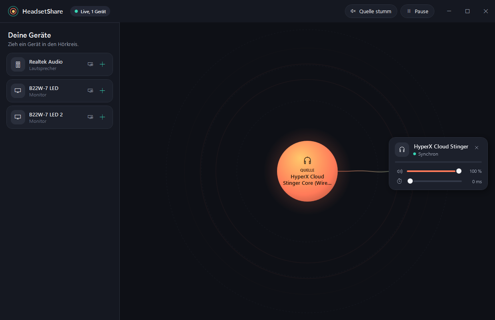

# HeadsetShare

Eine Windows-App, die den Ton deines PCs gleichzeitig auf mehrere USB-Headsets verteilt. Alle hören dasselbe.



## Installation

Lade die `.msi` vom [neuesten Release](https://github.com/abilas-sivarajah/HeadsetShare/releases/latest) und starte sie. HeadsetShare landet dann mit Startmenü- und Desktop-Verknüpfung auf deinem PC, ein eigenes .NET ist nicht nötig. Eine neuere MSI ersetzt die alte Version automatisch.

Die MSI ist nicht signiert, deshalb kann Windows SmartScreen warnen. Dann über **Weitere Informationen** und **Trotzdem ausführen** starten.

## So funktioniert es

1. Starte HeadsetShare.
2. Die Kugel in der Mitte ist die **Quelle**: Ihr Ton wird verteilt. Zieh ein anderes Gerät darauf, um sie zu wechseln.
3. Zieh deine Headsets von links in den **Hörkreis** oder klick auf **+**.
4. Läuft ein Headset dem anderen hörbar voraus, gib ihm über den Delay-Regler etwas Verzögerung.

Verteilt wird nur, was Windows auf der Quelle abspielt. Spielt Windows auf einem anderen Gerät, zeigt die App das an und kann mit einem Klick umstellen. Mit **Quelle stumm** schweigt zum Beispiel der Laptop, während die Headsets weiterlaufen.

## Funktionen

- Lautstärke, Stummschaltung, Delay und Name pro Gerät
- laufender Ausgleich der Clock-Drift, damit die Geräte nicht auseinanderlaufen
- Geräte mit unterschiedlicher Abtastrate
- Einstellungen werden gespeichert

## Grenzen

- Nur Windows, und nur Tonausgabe: Mikrofone der Headsets werden nicht verteilt.
- Die Funklatenz der Headsets kann die App nicht messen. Unterschiede gleichst du per Gehör mit dem Delay aus.
- Wird ein Dongle in einen anderen USB-Port gesteckt, kann Windows ihn als neues Gerät führen. Dann ziehst du es neu in den Kreis.
- Die Umstellung des Windows-Standardgeräts nutzt eine undokumentierte Windows-Schnittstelle. Lehnt Windows ab, stellst du es in den Soundeinstellungen um.

## Selbst bauen

Benötigt das .NET 10 SDK:

```powershell
dotnet run --project HeadsetShare
```

Tests laufen mit `dotnet test HeadsetShare.slnx`. Aufgebaut ist die App mit WPF und [NAudio](https://github.com/naudio/NAudio), die MSI mit [WiX](https://github.com/wixtoolset/wix).

## Automatische Releases

Jeder Pull Request und jeder Push auf `main` wird von GitHub Actions gebaut und getestet, und die MSI wird dabei einmal wirklich installiert und deinstalliert. Nach einem erfolgreichen Push auf `main` entsteht automatisch ein Release mit der MSI. Änderungen nur an Markdown-Dateien oder `docs/` lösen keinen Build aus.

Die Version ergibt sich aus dem letzten Tag, mit um 1 erhöhtem Patch. Für einen größeren Sprung setzt du `<Version>` in `HeadsetShare/HeadsetShare.csproj` höher, zum Beispiel auf `1.0.0`.
